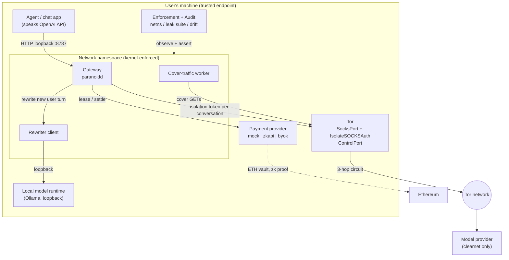
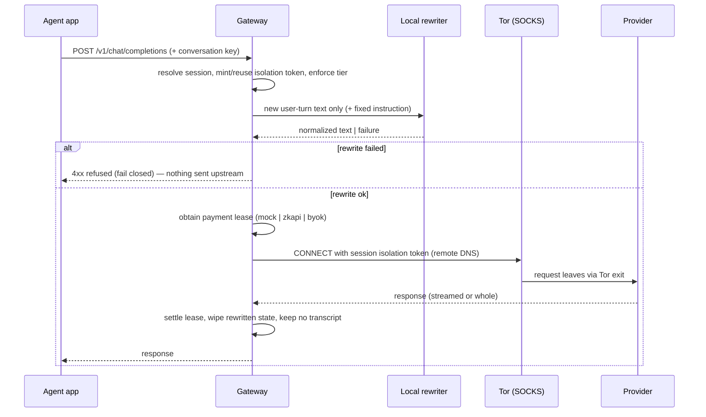
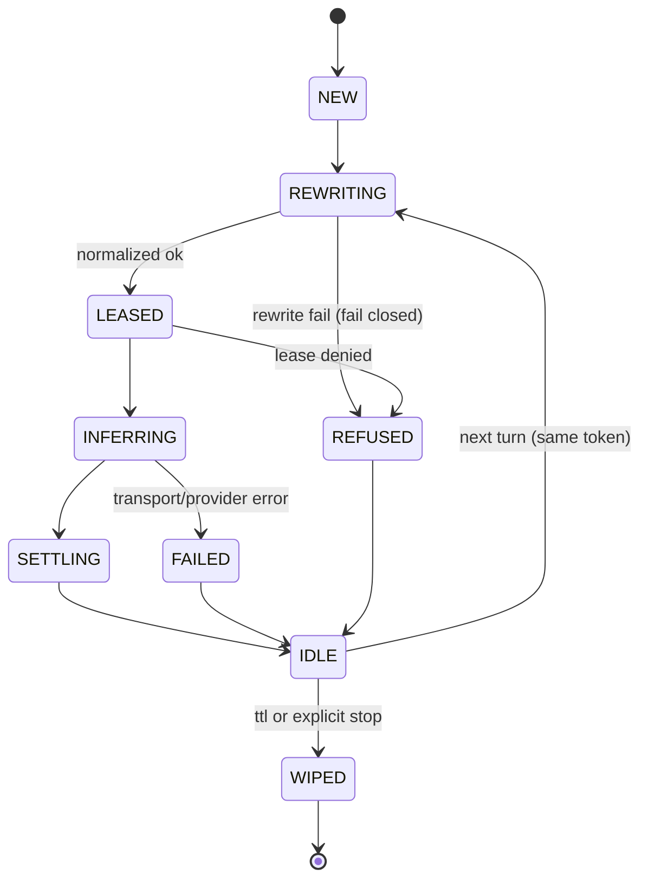

# Architecture

> Replaces the v0 architecture draft, which described a design this document supersedes. The v0
> errors and their corrections are catalogued in [PROBLEM.md](PROBLEM.md) §8.

The architecture is the chosen plan from [PLAN.md](PLAN.md) §4 made concrete: a **gateway we own**
in front of a **data plane we delegate**, with enforcement and verification as first-class
components rather than afterthoughts.

---

## 1. Design principles

1. **One boundary, kernel-enforced.** The anonymity boundary is a network namespace, not a
   configuration value.
2. **Fail closed.** Any layer that cannot do its job refuses the request. There is no silent
   fallback to a weaker path — a privacy tool that degrades quietly is a privacy tool that lies.
3. **No single party sees two of {identity, content, payment}.** This is the structural property
   inherited from zkAPI's design (analogy C in [PLAN.md](PLAN.md) §1) and preserved at every seam.
4. **Nothing sensitive touches disk.** Original prompts live in memory for the life of a request.
5. **Claims are testable.** Every guarantee maps to a check in [EVALUATION.md](EVALUATION.md); if it
   cannot be checked, it is not claimed.
6. **Degradation is explicit and user-visible.** Tiers are chosen, printed, and enforced.

---

## 2. Component overview



**Trust boundary:** everything inside the namespace is trusted; everything outside it is not. The
local model is reachable only over loopback and must never be a remote service — upstream's rewriter
connects **directly, outside Tor**, so a remote rewriter would defeat the entire design (A6).

---

## 3. Components

### 3.1 Gateway (`paranoid/gateway.py`)

The product surface: an OpenAI-compatible HTTP server bound to **`127.0.0.1:8787` only**.

- `POST /v1/chat/completions` — the hot path; supports streaming (SSE) and non-streaming.
- `GET /v1/models` — proxy to the resolved provider model list.
- Long-lived per-conversation state keyed by our own session token.

Responsibilities: parse and validate the request, map it to a session, enforce the tier, invoke the
rewriter, obtain a payment lease, forward the sanitized request through Tor with the session's
isolation token, return the response, settle, and wipe.

### 3.2 Session manager (`paranoid/session.py`)

Owns conversation identity and lifetime. **Conversation identity is derived, not accepted**: it is a
hash of a caller-supplied conversation key (or a fresh random token when absent), so a client cannot
assert someone else's session, and two clients cannot accidentally share an isolation token.

```python
@dataclass(frozen=True)
class Session:
    id: str                    # opaque, non-secret handle
    isolation_token: str       # SOCKS auth token -> Tor isolation identity
    tier: Tier
    created_at: float
    circuit_id: str | None     # observed, not assumed
    exit_fingerprint: str | None

class SessionManager:
    def start(self, conversation_key: str | None, tier: Tier) -> Session: ...
    def get(self, session_id: str) -> Session | None: ...
    def stop(self, session_id: str) -> CleanupReport: ...   # frees token, wipes state
    def reap_idle(self, ttl_seconds: int) -> list[str]: ...
```

No session state is ever written to disk. Sessions are bounded in number; the oldest idle session is
reaped rather than growing without limit.

### 3.3 Tor transport (`paranoid/tor.py`)

- **Isolation:** per-session credentials on the SOCKS5 connection to Tor, requiring
  `IsolateSOCKSAuth` on the `SocksPort`. This is the isolation primitive (see
  [LAYER-OPTIONS.md](LAYER-OPTIONS.md) §3).
- **Observation:** the control port is used only to *read* state — `GETINFO circuit-status`,
  `GETINFO net/listeners/socks`, version checks — so isolation claims can be verified rather than
  asserted.
- **Recovery:** `NEWNYM` is available solely as an operator-triggered "my circuits look broken"
  escape hatch, is never in the per-request path, and is rate-limit aware.
- **No fallback:** if Tor is unreachable, requests fail. There is no direct-connection path to
  disable or misconfigure, because the enforcement layer makes one impossible.

### 3.4 Rewriter (`paranoid/rewriter.py`)

Fail-closed transformation of **`user`-role text parts only**.

```python
@dataclass(frozen=True)
class RewriteResult:
    text: str
    ok: bool
    reason: str | None          # "timeout" | "malformed" | "refusal" | "too_long" | ...
    essential_retained: list[str] | None   # filled by the eval harness, not the hot path

class Rewriter:
    def rewrite(self, text: str) -> RewriteResult: ...
```

Contract, matching upstream's documented behaviour so results are comparable:

| Rule | Behaviour |
| --- | --- |
| Input | the **new user turn's text only** — not history, not images, not tool definitions |
| Instruction | fixed; extract task, necessary context, constraints; rebuild as concise task-first prose; preserve code, quotes, identifiers, paths, URLs, numbers, exact output constraints; never answer, never add facts, never resolve missing context |
| On malformed/truncated/refused output | **fail closed** — refuse the request |
| Limits | bounded input/output per turn and a bounded call timeout inside the request deadline |
| Cache | memory only, bounded, keyed by message digest, scoped to the immediately previous history, never persisted, never cross-session |
| Unknown content types | refuse rather than bypass |

Two consequences that must be documented for users, because they are easy to get wrong:
normalised wording **may legitimately equal the original** (especially code and quotes), so "no raw
prompt" means *no bypass of this processing*, not *every character changed*; and text placed in
`system`, `developer`, `assistant`, or tool messages is **outside** this protection.

### 3.5 Cover traffic (`paranoid/cover.py`)

Opt-in, bounded, Poisson-scheduled dummy HTTPS GETs, structurally identical to upstream's documented
design because that design's discipline is the point:

- random exponential interarrival, independent of prompts, completions, or wallet activity;
- randomised first arrival, **no startup burst**;
- fixed worker pool, **unbuffered** dispatch — saturation **drops** arrivals; there is no queue, no
  catch-up burst, and no inference-triggered acceleration;
- per-request timeout and response-size cap; bodies discarded, never logged or retained;
- per-worker SOCKS identities that never derive from inference or payment context;
- authenticated Tor routing only (remote DNS, TLS verified), no direct fallback, no global `NEWNYM`;
- aggregate counters only — attempted/succeeded/failed/skipped and bytes, at a fixed interval;
- hard bandwidth budget, **disabled by default**.

Targets must be resources we own or are explicitly permitted to poll. This is a hard requirement, not
a recommendation: the obsolete upstream helper that hammered public APIs by default is the
counter-example.

### 3.6 Payment (`paranoid/payment.py`)

An interface with interchangeable adapters, so the payment question (U1) is configuration rather
than architecture:

```python
class PaymentProvider(Protocol):
    def lease(self, budget_usd: Decimal) -> Lease: ...      # -> short-lived, capped credential
    def settle(self, lease: Lease) -> Receipt: ...          # -> signed usage receipt
    def status(self) -> PaymentStatus: ...                  # -> balance, anonymity-set disclosure
```

| Adapter | Use | Notes |
| --- | --- | --- |
| `mock` | development, tests, CI | Fully simulates lease/settle; no funds, no chain |
| `zkapi` | production intent | Delegates proofs and settlement to upstream; never hand-rolled |
| `byok` | T0/T1 fallback | User's own key — and the docs must state that the key *is* the identity |

`status()` is deliberately part of the interface: it is where the anonymity-set size and the
operator-visibility caveats get surfaced to the user at run time (SC8), rather than buried in a
README nobody reads.

### 3.7 Enforcement and audit (`paranoid/enforce.py`, `paranoid/audit.py`)

The component upstream does not have, and the reason to trust the rest.

- **Launch:** run the data plane inside a network namespace via `oniux` (preferred) or a hand-rolled
  `unshare -n` + Tor wiring (fallback). Verify the namespace actually has no route to the outside
  except the Tor path before declaring the tier active.
- **Leak checks:** DNS behaviour (resolver reachable only through Tor), IPv6 (no leakage around an
  IPv4-only path), the **rewriter's direct connection** (must be loopback or absent), and telemetry
  (there is none, and the tests assert no outbound requests beyond Tor and the local model).
- **Drift detection:** assert the running configuration still matches the declared tier; a session
  that silently loses its isolation token fails loudly rather than continuing unprotected.
- **No-persistence audit:** post-run assertions that no prompt text reached disk, logs, or temp files.

---

## 4. Request lifecycle



**Session state machine.** Every transition is observable in `/admin/status`:



Note what is **absent**: there is no transition from any failure state to "sent anyway". That is the
architecture's core safety property.

---

## 5. Interfaces

### 5.1 HTTP surface

| Method | Path | Purpose |
| --- | --- | --- |
| `POST` | `/v1/chat/completions` | OpenAI-compatible chat; streaming or whole |
| `GET` | `/v1/models` | Available models (provider passthrough) |
| `GET` | `/admin/status` | Tier, active sessions, isolation tokens (hashed), cover state, last leak-test result |
| `POST` | `/admin/session` | Start a session explicitly; returns id + tier |
| `DELETE` | `/admin/session/{id}` | Stop and wipe a session |
| `GET` | `/admin/audit` | Latest leak-suite and persistence-audit results |
| `GET` | `/healthz` | Liveness only; reveals nothing about configuration |

Rules: bind to loopback only; **never** log request or response bodies; treat all inbound headers as
untrusted; `X-Paranoid-Tier` may *downgrade* per request but never upgrade silently beyond the
configured ceiling; the session handle is an opaque id, not a credential.

### 5.2 Configuration (`~/.config/paranoid/config.toml`)

```toml
# Declared intent. The gateway refuses to start if the running environment
# cannot satisfy the requested tier.
tier = "T2"

[gateway]
host = "127.0.0.1"          # loopback only; a routable bind is rejected
port = 8787
max_sessions = 32
session_ttl_seconds = 1800

[tor]
socks_port = 9050           # must have IsolateSOCKSAuth enabled
control_port = 9051
control_auth = "cookie"
require_isolation_auth = true   # refuse to start if IsolateSOCKSAuth is off
rotation_mode = "per_conversation"   # never "newnym"

[rewriter]
url = "http://127.0.0.1:8012"    # loopback ONLY; non-loopback is a hard error
model = "qwen3.8-flash-next"
timeout_seconds = 90
fail_closed = true              # there is no supported value of false in T2+
max_input_bytes = 131072

[sandbox]
mode = "oniux"                  # oniux | netns | none   ("none" is T0/T1 only)
allow_tier_downgrade_to_none = false

[cover]
enabled = false                 # opt-in, always
rate_per_second = 0.5           # far below upstream's 5/s default, on purpose
concurrency = 2
max_response_bytes = 65536
targets = []                    # required when enabled; must be ours or permitted

[payment]
provider = "mock"               # mock | zkapi | byok
budget_per_session_usd = "2.00"
disclose_anonymity_set = true   # prints posture at startup and in /admin/status

[audit]
leak_suite_on_start = true
persistence_audit = true
```

### 5.3 Python module map

```
src/paranoid/
  __init__.py
  cli.py            # typer entry point: run | doctor | leaktest | tiers | version
  config.py         # pydantic-settings model + validation (fail-fast on unsafe values)
  gateway.py        # ASGI app: OpenAI-compatible surface + admin
  session.py        # SessionManager, isolation tokens, tiers, reaping
  tor.py            # SOCKS client wiring, control-port observation, circuit reports
  rewriter.py       # fail-closed rewrite client + normalization contract
  cover.py          # bounded Poisson scheduler + permitted-target policy
  payment/
    base.py         # PaymentProvider protocol, Lease, Receipt
    mock.py
    zkapi.py        # thin adapter over upstream client; no crypto reimplementation
    byok.py
  enforce.py        # namespace launch (oniux/netns), environment assertions
  audit.py          # leak suite, persistence audit, drift detection
  redact.py         # logging redaction; used by every module that logs
```

---

## 6. Failure modes

Every row states the failure **and** what the user sees. Silence is treated as a defect.

| Failure | Detection | Behaviour |
| --- | --- | --- |
| Tor not running / SOCKS refused | connect error | Request refused; tier marked UNSATISFIED; `/admin/status` shows why. **No direct fallback** |
| `IsolateSOCKSAuth` disabled | startup probe | Gateway **refuses to start** in T2+ |
| Control port unavailable | connect error | Degraded to "unverified isolation": requests proceed (isolation is still enforced by SOCKS) but the isolation claim is reported as unverified, never as passing |
| Rewriter unreachable / times out | timeout | **Fail closed**: request refused. Optional explicit T1 downgrade sends the raw prompt only if the user pre-authorised that downgrade |
| Rewriter returns malformed / truncated / refused output | response validation | Fail closed |
| Rewriter output would drop a constraint | harness/best-effort check | Logged as a quality sample; never auto-substituted with the original |
| Payment lease denied / insufficient balance | provider response | Request refused before any content leaves; the original prompt is never sent speculatively |
| Payment provider unreachable | exception | Refused; session marked so the user can see it is a payment problem, not a network one |
| Provider rejects Tor exit (403/429) | HTTP status | Surfaced as a distinct, actionable error naming the provider's behaviour; **no** automatic direct-connection retry |
| Cover traffic target failing | aggregate counters | Rate reduced or cover disabled; a failing target is never retried aggressively against the operator's wishes |
| Cover traffic saturating bandwidth | budget counter | Arrivals dropped by design; the budget is a ceiling, not a target |
| Namespace unavailable (no userns) | launch failure | Tier drops to T1 and says so; `allow_tier_downgrade_to_none = false` means it refuses rather than silently running unisolated |
| Session leaks between conversations | `/admin/status` mismatch | Session invalidated and re-minted; any request on a mismatched token is refused |
| Config contains an unsafe value (non-loopback rewriter, routable bind) | config validation | Startup refusal with the specific offending key |
| Disk writes attempted for prompt state | persistence audit | Treated as a security bug; CI gate fails |

---

## 7. Deployment topologies

| Topology | Components | Tier ceiling | Notes |
| --- | --- | --- | --- |
| **Single host, app-level** | Gateway on loopback; Tor SOCKS; local model | T1 | Fastest to adopt; isolation is conventional, not kernel-enforced. Honest label: weaker |
| **Single host, netns** | Gateway + data plane inside `oniux`/netns | T2 | The intended default |
| **Split VM** | Gateway VM has no direct route except to a Tor gateway VM | T3 | Strongest; heavy. Documented as advanced |
| **Mixnet request path** | T3 adds a mixnet for the request leg only | T3 (experimental) | Benchmarked before it is offered; response path stays on Tor |

---

## 8. What this architecture does not do

Stated here so it cannot be quietly assumed later. The authoritative list is
[THREAT-MODEL.md](THREAT-MODEL.md).

- It does not hide prompt content from the provider — the provider must read the prompt to answer.
- It does not defeat a provider who colludes with the user's guard relay to correlate timing.
- It does not make the payment anonymity set large; it reports how small it is.
- It does not protect a compromised local machine, keylogger, or screen capture.
- It does not anonymise attachments, images, audio, or text the caller puts outside the `user` role.
- It does not protect against a global passive adversary, and its cover traffic is not constant-rate.
- It does not run infrastructure on the user's behalf, so it adds no new party that can correlate.

---

*Next: [THREAT-MODEL.md](THREAT-MODEL.md) — for whom this holds, and against whom it does not.*
