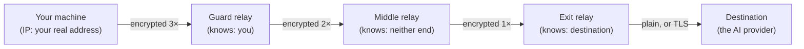

# 02 — Anonymity Networks: How Tor Works

## The question

How can you talk to a server without anyone being able to connect your identity to the conversation —
and why is it not enough to just "use Tor"?

## First principle

**No single party should know both who you are and what you are saying.**

Everything in Tor follows from that. If one relay knew both the source and the destination, it would
be a perfect observer, and you would have replaced your ISP with a different, less accountable ISP.
So Tor splits the knowledge across several parties chosen so that no single one has the whole
picture — and relies on the assumption that they do not collude.

That last clause is not a detail. **The entire protection rests on non-collusion**, and the most
serious attacks against Tor are attacks that break that assumption. Hold that thought for lesson 03.

## How it actually works

Tor builds a **circuit**: a path through three relays — an entry (or **guard**), a **middle**, and an
**exit**.

The client encrypts the payload in **layers**, one per relay. Each relay peels exactly one layer,
learning only its immediate neighbour in each direction:

| Relay | Knows | Does not know |
| --- | --- | --- |
| **Guard** | Your IP address; that you use Tor; the volume and timing of your traffic | Where the traffic is going |
| **Middle** | Only its two neighbours within the path | Your IP; the destination |
| **Exit** | The destination address; the traffic shape forwarded to it | Your IP address |

Your **own machine** knows everything, of course. This is why the endpoint sits inside the trust
boundary, and why any privacy design that ignores the local machine is only defending the perimeter
while leaving the vault door open.

### Why three hops, and why the guard is special

A middle relay exists purely so that the guard and the exit are not directly adjacent. With only two
hops, a single malicious relay would know both ends.

Guards are **long-lived on purpose**. If your entry relay changed every time, an adversary who
controls even a small fraction of relays would eventually be your entry point, and could watch you
repeatedly. Tor therefore pins a small set of guards for months at a time. This is a deliberate
tradeoff: you are more exposed to *your specific guard* being hostile, and less exposed to an
adversary who is trying to *become* your entry point by grinding relay identities.

That tradeoff has a direct consequence for this project: **the guard is a high-value, long-term
observer of your traffic patterns** — which is precisely why the provider-plus-guard attack in
lesson 03 is the hard one.

## Circuits are reused, and that matters

Beginners assume Tor builds a fresh circuit per request. It does not, and that is deliberate. Circuit
construction is expensive — it means network latency, CPU, and consensus lookups — so Tor keeps using
a circuit until it becomes "dirty", by default after **10 minutes** (`MaxCircuitDirtiness`).

Reuse is also *good* for privacy when circuits are shared with the right people (nobody else) and
*bad* when they are shared with the wrong ones. Which brings us to the central practical problem.

### The stream-isolation problem

One Tor client serves many streams — several conversations, several applications, background
updates. If two of those streams share a circuit, then:

- a **hostile exit** learns that those streams belong to the same user;
- the **destination** can infer it too, because both streams arrive from the same exit;
- an observer between exit and destination sees the same thing.

So if your two conversations share a circuit, you have handed the provider an easy link between them —
defeating the entire point of "a separate circuit per conversation".

Tor cannot figure out which streams belong together by itself. It has no idea whether two sockets
come from the same application, the same account, or the same conversation. So it needs to be **told**
— and that is what **stream isolation** is.

Each stream carries an **isolation profile**: a set of key/value properties. Two streams may share a
circuit only if their profiles are compatible. Tor's path specification defines several properties,
and is explicit about which is trustworthy:

| Isolation property | Strength (per the spec) |
| --- | --- |
| Application address (which local IP connected) | Weak — only distinguishes `127.0.0.1` from `::1` |
| Proxy address / proxy protocol | Weak |
| **Application-provided isolation tokens** | **Strong** — "only these are strong" |

For a SOCKS5 connection, the application-provided token is carried in the **SOCKS username and
password fields**. Set a distinct username per conversation, and Tor gives those conversations
different circuits. That is the whole mechanism.

> **The practical rule this produces:** isolation is expressed as a *label on each connection*, not as
> a global action. Per-conversation isolation means "label this conversation distinctly", not "flush
> all my circuits".

### Why `NEWNYM` is the wrong tool (the mistake the first draft made)

The original version of this project's plan said: *"use Stem to request a new circuit before each
interaction"* — that is, send Tor's `NEWNYM` control signal per request. It sounds right and it is
wrong, for four independent reasons:

1. **It is global, not per-conversation.** `NEWNYM` makes *new* requests avoid *old* circuits. It does
   not tell Tor that conversation A and conversation B are distinct for the rest of their lives. You
   are relying on timing — "the flush happened between them" — rather than on a label.
2. **It is rate-limited.** Tor deliberately slows down clients that signal repeatedly — on the order
   of a 10-second cooldown, roughly six rotations per minute. A per-request rotation budget is
   unachievable by design.
3. **It churns the whole client.** Every flush disturbs unrelated activity, and forces circuit
   rebuilding, which costs latency for everyone.
4. **It fights Tor's own guidance.** The spec says that when a *strong* isolation property is present,
   a circuit should be reused for a long time. Rotation is the fallback for when you have no strong
   property to offer — which is exactly the situation stream isolation solves properly.

So the corrected design is: **a per-conversation SOCKS auth token, with the control port used to
*observe* circuits rather than to churn them.**

One honest caveat, from Tor's own behaviour: SOCKS cannot *prove* to your application that two
sockets used different circuits. You can only ask the control port what it actually did and report
the answer. That is why this project's status output has an **"unverified"** state rather than
claiming a green light it cannot substantiate. A tool that cannot verify a property should say so,
not assume it.

## Where it breaks

**1. The last hop to a clearnet destination.** Your request leaves Tor at an exit relay, which sees
where it is going. If the provider is not itself reachable inside the Tor network (no `.onion`
address), then the exit — and anyone watching that link — sees destination and traffic shape.
**Tor does not fix this, and neither does any amount of encryption.** It is a structural property of
routing to a public destination. The only real fixes are: the destination lives inside the network, or
you accept that the final hop is observable.

**2. Timing correlation.** This is lesson 03's subject, and it is the attack that matters most here.
Briefly: the guard knows when you sent bytes, the provider knows when it received them. If they
compare notes, the timing matches even though neither can see the content. Tor was not designed to
defeat an adversary who can see both ends.

**3. Collusion.** An adversary controlling your guard *and* your exit sees both ends and deanonymises
you completely. Controlling two relays in one path is not as hard as it sounds; controlling the
specific pair is harder, which is what the 3-hop design buys.

**4. Your own configuration.** Tor protects the connections you route through it. If some other
process on your machine makes a connection outside it — a chatty desktop app, a resolver query, an
IPv6 fallback — you have a direct link to your real IP, and Tor is irrelevant. This is an endpoint
problem, covered in lesson 06, and it is *the* most common way a Tor-based setup leaks in practice.

**5. Fingerprinting of the traffic itself.** Even with the source hidden, the *shape* of your traffic
can be recognisable: a TLS handshake to a known endpoint, a 3 MB streamed response, a distinctive
timing pattern. Anonymity is not the same as indistinguishability.

## What this means here

- **Decision D4:** isolation is a per-conversation SOCKS auth token with `IsolateSOCKSAuth` enabled;
  `NEWNYM` is never in the request path. The gateway refuses to start if isolation is not enabled,
  rather than running unprotected.
- **Milestone M0** exists to *test* this claim rather than assume it: open many concurrent sessions,
  ask the control port which circuit each stream landed on, and check that unrelated live
  conversations never share one. See [../EVALUATION.md](../EVALUATION.md) §3.
- **The "unverified" state** in the status output is a deliberate design choice that follows from the
  SOCKS caveat above.
- **The last-hop problem** is why [../THREAT-MODEL.md](../THREAT-MODEL.md) rates the exit relay and the
  provider as able to observe destination and shape, and why the guard-collusion attack (`AD5`) is
  listed as *out of scope* rather than pretended away.

## Self-check

1. Your guard relay is malicious and your exit relay is honest. What does the attacker learn? Now
   reverse it. What if the *same* adversary controls both?
2. Why would rotating circuits per request be *worse* than reusing one circuit per conversation, in
   terms of both privacy and performance?
3. Two conversations from your machine share a circuit. Who can tell, and what precisely do they
   learn?

Answers

1. Malicious guard + honest exit: the attacker learns your IP, that you use Tor, and your traffic
   volume and timing — but not your destination. Malicious exit + honest guard: it learns your
   destination and traffic shape, but not your IP. **Both together: it learns your IP *and* your
   destination, which is deanonymisation.** This is why the threat is about collusion, not about any
   single relay being bad.

2. Privacy: frequent global flushing destroys the stable circuit reuse that Tor's design intends,
   makes timing-based grouping *more* deterministic rather than less (your conversations become
   separated by the flush events, which an observer can detect), and gains nothing that a proper
   isolation token does not give you more precisely. Performance: each flush forces new circuit
   construction, adding latency, and Tor rate-limits the signal anyway. The correct mental model is
   *labelling connections*, not *flushing the client*.

3. A hostile exit, the destination, and anyone observing between them — they learn that both streams
   come from one user, and can therefore link the conversations. This is exactly the linkage problem
   from lesson 01, and per-conversation isolation tokens are the fix.

---

*Next: [03 — Traffic analysis and mixnets](03-traffic-analysis-and-mixnets.md)*
